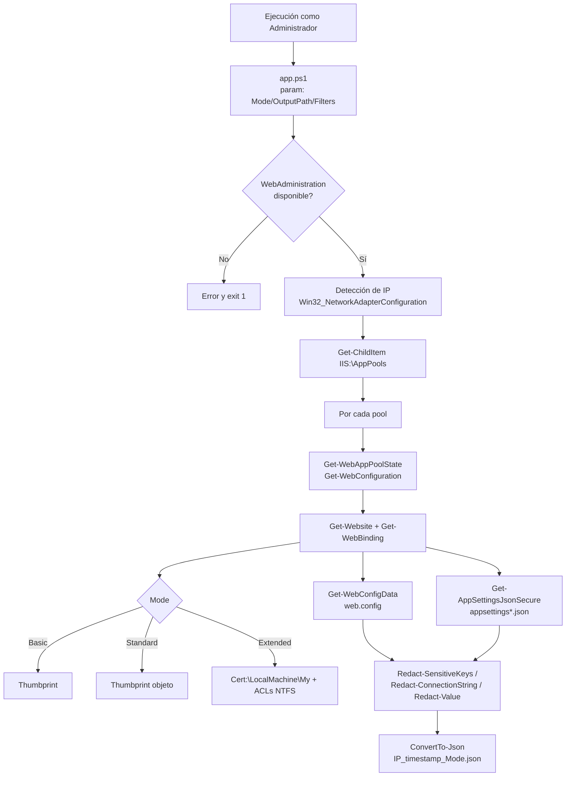
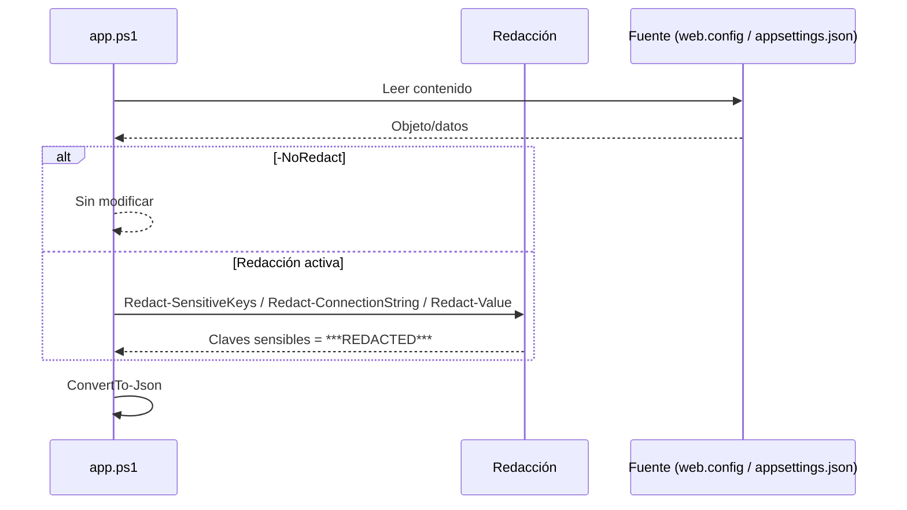

# pool-datadumper

Volcado de configuración IIS (App Pools, Sites, certificados SSL, web.config, appsettings.json, ACLs NTFS) a JSON con redacción automática de secretos.

[](https://microsoft.com/powershell)
[](LICENSE)
[](https://github.com/bi0punk/pool-datadumper/actions/workflows/ci.yml)

## Contenido

- [Características](#características)
- [Arquitectura](#arquitectura)
- [Stack](#stack)
- [Estructura del repositorio](#estructura-del-repositorio)
- [Instalación](#instalación)
- [Uso](#uso)
- [Configuración](#configuración)
- [Tests / CI](#tests--ci)
- [Roadmap](#roadmap)
- [Licencia](#licencia)

## Características

- Volcado de Application Pools, Sites, aplicaciones, bindings y directorios virtuales.
- Lectura de `web.config` (connection strings, appSettings, customErrors, compilación).
- Lectura de `appsettings*.json` con redacción recursiva de claves sensibles.
- Recopilación opcional de certificados SSL, ACLs NTFS, CPU y RapidFailProtection.
- Redacción automática de secretos activada por defecto.
- Detección de IP del host para nombrar el archivo de salida con timestamp.
- Filtrado por pool (`-PoolFilter`) y por sitio (`-SiteFilter`).
- Tres niveles de recolección: Basic, Standard y Extended.

## Arquitectura



Flujo de redacción de secretos (no aplica con `-NoRedact`):



## Stack

- PowerShell 5+
- Módulo `WebAdministration` (IIS Management Console)
- `PSScriptAnalyzer` para linting (CI)

## Estructura del repositorio

```
pool-datadumper/
├── app.ps1                     # Script principal de volcado
├── .github/workflows/ci.yml    # CI (PSScriptAnalyzer)
├── LICENSE
└── README.md
```

## Instalación

- Windows con IIS instalado.
- Ejecutar como **Administrador**.
- Módulo `WebAdministration` disponible.
- Para tests: `Install-Module -Name Pester -Force -SkipPublisherCheck`.

No requiere instalación adicional: el script valida al inicio que el módulo `WebAdministration` y la unidad `IIS:\` estén disponibles.

## Uso

```powershell
# Volcado estándar (redacción de secretos activada)
.\app.ps1

# Volcado extendido (SSL detallado, ACLs, CPU, RapidFailProtection)
.\app.ps1 -Mode Extended

# Volcado básico (solo pools y bindings)
.\app.ps1 -Mode Basic

# Personalizar salida
.\app.ps1 -OutputPath D:\Backups -JsonDepth 15

# Filtrar por pool/sitio
.\app.ps1 -PoolFilter "MyApp*" -SiteFilter "MySite"

# DESACTIVAR redacción (peligroso - expone credenciales)
.\app.ps1 -NoRedact
```

## Configuración

Parámetros del script:

| Parámetro | Tipo | Default | Descripción |
|---|---|---|---|
| `-Mode` | `Basic` \| `Standard` \| `Extended` | `Standard` | Nivel de recolección |
| `-OutputPath` | string | `C:\Temp` | Directorio de salida |
| `-NoRedact` | switch | `false` | Deshabilita la redacción de secretos |
| `-PoolFilter` | string | `*` | Filtro wildcard por nombre de App Pool |
| `-SiteFilter` | string | `*` | Filtro wildcard por nombre de sitio |
| `-JsonDepth` | int | `10` | Profundidad de `ConvertTo-Json` |

Modos de contenido:

| Modo | Contenido |
|---|---|
| Basic | Pools, bindings, thumbprints SSL, paths |
| Standard | Basic + web.config, appsettings.json (redactado) |
| Extended | Standard + SSL detallado, ACLs NTFS, CPU/RapidFail config |

Seguridad: por defecto **todas** las credenciales se redactan automáticamente (connection strings `Password=***REDACTED***`; app settings con claves sensibles; `appsettings.json` con redacción recursiva de claves que contengan `password`, `secret`, `key`, `token` o `connection`). Usa `-NoRedact` solo para debugging local.

## Tests / CI

Se recomienda Pester para tests unitarios del script PowerShell:

```powershell
# Instalar Pester si no está disponible
Install-Module -Name Pester -Force -SkipPublisherCheck

# Ejecutar tests
Invoke-Pester ./tests
```

Tests sugeridos:

- Mock de `Get-ChildItem IIS:\AppPools` y `Get-WebConfiguration`.
- Validación de redacción de connection strings.
- Validación de JSON malformado.
- Manejo de `$null` en `$physicalPath`.

El workflow `.github/workflows/ci.yml` ejecuta `PSScriptAnalyzer` con `Invoke-ScriptAnalyzer -Path . -Recurse -EnableExit` en `windows-latest`.

## Roadmap

- [x] Volcado por niveles (Basic/Standard/Extended) con redacción de secretos
- [x] Recopilación SSL, ACLs NTFS, CPU y RapidFailProtection
- [x] Filtros por pool/sitio y salida JSON con timestamp
- [ ] Suite de tests Pester equivalente a los tests sugeridos

## Licencia

MIT
